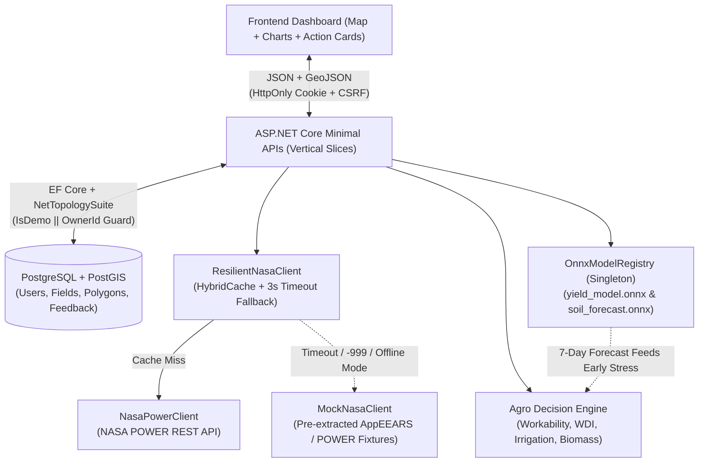

# FarmFlow Backend & AI/ML Architecture

## 1. Overview & Architectural Philosophy

> **Scope Alignment:** This architecture implements the feature tiers (`P0`, `P1`, `P2`) and anti-scope-creep guardrails defined in [docs/scope.md](file:///Users/spnch/documents/code/hackathons/NASA-2026/FarmFlow_Nasa/docs/scope.md).

**FarmFlow** is an agricultural monitoring and decision-support system powered by NASA Earth Science satellite observations (**GPM IMERG, MODIS/VIIRS, ECOSTRESS, SMAP**), deterministic agronomic models, and in-process AI/ML inference.

To maximize development velocity during the hackathon and eliminate merge conflicts between backend developers, the backend uses a **Modular Monolith with Vertical Slice Architecture** built on **.NET 10 Minimal APIs**.

### Key Principles
- **Vertical Slices over Layered (N-Tier) Architecture:** Instead of splitting code horizontally across `Controllers`, `BLL/Services`, `DAL/Repositories`, and `DTO` projects, every feature lives in a self-contained slice under `Features/`. Each endpoint file encapsulates its own request/response records, validation, database queries, and domain calculations.
- **Zero Unnecessary Abstractions:** No `IFieldRepository` or `IFieldService` interfaces for single-implementation logic. Inject `AppDbContext` directly into endpoint handlers.
- **Strategic Abstraction Where It Counts (`INasaClient`):** External satellite APIs are abstracted behind `INasaClient` with a resilient fallback decorator and caching layer so the application never fails or lags during a live demo.
- **In-Process AI/ML Inference via ONNX:** Models are trained in Python (`scikit-learn` + `PyTorch`), exported to `.onnx`, and executed natively inside the .NET process via `Microsoft.ML.OnnxRuntime` with zero microservice/network overhead.

---

## 2. Technology Stack

| Layer | Technology | Purpose |
| :--- | :--- | :--- |
| **Runtime & Web Framework** | **.NET 10** + **ASP.NET Core Minimal APIs** | High-performance HTTP APIs with minimal ceremony |
| **Authentication & Security** | **ASP.NET Core Google OAuth (`Microsoft.AspNetCore.Authentication.Google`) + Cookie Auth + `IAntiforgery` + `ForwardedHeaders`** | Google-only sign-in keyed by `sub`, persistent `HttpOnly` session cookies, CSRF protection, and reverse-proxy HTTPS handling |
| **Database** | **PostgreSQL + PostGIS (`imresamu/postgis:17-3.5-alpine`)** | Relational storage + native spatial types (`Polygon`, `Point`, GeoJSON) |
| **ORM & Spatial Mapping** | **EF Core 10** + `Npgsql.EntityFrameworkCore.PostgreSQL.NetTopologySuite` | Direct mapping of PostGIS geometries to `NetTopologySuite` types |
| **GIS / Geometry Engine** | **NetTopologySuite** + `NetTopologySuite.IO.GeoJSON4STJ` | Polygon validation, centroid calculation, and area conversion (hectares) |
| **Caching & Resilience** | `IHttpClientFactory` + `HybridCache` / `IMemoryCache` | Caching NASA coordinate responses and falling back to mock fixtures |
| **AI/ML Inference (.NET)** | `Microsoft.ML.OnnxRuntime` | Running tabular ML and Deep Learning time-series models in-process |
| **AI/ML Training (Python)** | **Python 3.12**, `scikit-learn`, `skl2onnx`, `PyTorch`, `onnx` | Offline model training and `.onnx` artifact generation |
| **API Documentation** | **Scalar (`Scalar.AspNetCore`)** + `.http` files | Interactive OpenAPI testing and team alignment |
| **Testing** | **`xUnit v3`**, **`Shouldly`**, **`WebApplicationFactory`**, **`Testcontainers.PostgreSql`**, **`Respawn`** | Fast unit tests, fake HTTP resilience tests, and isolated PostGIS endpoint tests |

---

## 3. Repository & Directory Structure

```text
backend/
├── docs/
│   └── architecture.md                        # This architecture document
├── docker-compose.yml                         # PostgreSQL + PostGIS container setup
├── ml/                                        # Python offline training pipeline
│   ├── pyproject.toml / requirements.txt
│   ├── data/                                  # Historical NASA POWER & AppEEARS training datasets
│   ├── train_yield_model.py                   # Scikit-learn Random Forest / GBDT -> yield_model.onnx
│   └── train_soil_forecast.py                 # PyTorch 1D-CNN / LSTM -> soil_forecast.onnx
└── src/
    └── FarmFlow.Api/
        ├── Program.cs                         # DI registration, middleware, endpoint mapping
        ├── appsettings.json
        ├── Infrastructure/
        │   ├── Auth/
        │   │   ├── AuthConfiguration.cs       # Cookie + Google OAuth (sub-keyed), CSRF, ForwardedHeaders, returnUrl guard
        │   │   └── FieldAccessExtensions.cs   # Shared SQL visibility filter (IsDemo || OwnerId == currentUserId) & current user ID resolution
        │   ├── Database/
        │   │   ├── AppDbContext.cs            # EF Core context with PostGIS & User/Field identity configuration
        │   │   ├── DbSeeder.cs                # Idempotent per-ID seeder for the 4 public demo fields
        │   │   └── Entities/
        │   │       ├── User.cs                # GoogleSubjectId (sub), Email, GoogleDisplayName, CustomDisplayName, AvatarUrl
        │   │       ├── Field.cs               # Polygon, Centroid, AreaHa, CropType, PlantedAt, OwnerId?, IsDemo
        │   │       └── AlertFeedback.cs       # Farmer feedback on alerts (Yes/No accuracy)
        │   ├── Spatial/
        │   │   └── GeoCalculator.cs           # NetTopologySuite area (ha) & centroid calculation
        │   ├── Nasa/
        │   │   ├── INasaClient.cs             # Unified satellite data contract
        │   │   ├── NasaModels.cs              # NasaDailyMetric, FieldSatelliteSeries
        │   │   ├── NasaPowerClient.cs         # Live NASA POWER REST client + -999 sanitizer
        │   │   ├── MockNasaClient.cs          # Realistic scenario fixtures for demo stability
        │   │   ├── ResilientNasaClient.cs     # Caching + automatic fallback wrapper
        │   │   └── Fixtures/                  # Pre-extracted JSON fixtures (Healthy, Stress, Pest/Rain)
        │   └── Ml/
        │       ├── OnnxModelRegistry.cs       # Singleton InferenceSession manager
        │       └── Models/
        │           ├── yield_model.onnx       # Tabular yield regressor
        │           └── soil_forecast.onnx     # Deep Learning 7-day soil/ET forecaster
        └── Features/
            ├── Auth/
            │   ├── StartGoogleLogin.cs        # GET  /api/auth/google (OAuth challenge + safe returnUrl)
            │   ├── GetCsrfToken.cs            # GET  /api/auth/csrf (Anti-forgery cookie + request token)
            │   ├── GetCurrentUser.cs          # GET  /api/auth/me (authenticated state + effective displayName)
            │   └── Logout.cs                  # POST /api/auth/logout (CSRF-protected session sign-out)
            ├── Users/
            │   └── UpdateMyProfile.cs         # PATCH /api/users/me (CustomDisplayName update)
            ├── Fields/
            │   ├── CreateField.cs             # POST /api/fields (Auth + CSRF, OwnerId, IsDemo = false)
            │   ├── GetFields.cs               # GET  /api/fields (DB-filtered: IsDemo || OwnerId)
            │   ├── GetFieldById.cs            # GET  /api/fields/{id} (404 on missing or non-owned private)
            │   └── DeleteField.cs             # DELETE /api/fields/{id} (401/403/404 ownership & demo guard)
            ├── AgroAnalytics/
            │   ├── AgroFormulas.cs            # Pure static calculation methods for agronomic indices
            │   ├── GetFieldDashboard.cs       # GET  /api/fields/{id}/dashboard (Unified metrics + alerts)
            │   ├── GetWorkabilityWindow.cs    # GET  /api/fields/{id}/workability (48h field & spray status)
            │   ├── GetEarlyStressAlert.cs     # GET  /api/fields/{id}/stress (WDI + Smart Irrigation mm)
            │   └── GetBiomassTrend.cs         # GET  /api/fields/{id}/biomass (NDVI series + anomaly scout)
            ├── Predictions/
            │   ├── PredictYield.cs            # GET  /api/fields/{id}/predictions/yield
            │   └── ForecastSoilMoisture.cs    # GET  /api/fields/{id}/predictions/soil-forecast
            └── Alerts/
                ├── GetActiveAlerts.cs         # GET  /api/alerts (Prioritized action cards across all fields)
                └── SubmitAlertFeedback.cs     # POST /api/alerts/{id}/feedback
└── tests/
    └── FarmFlow.Api.Tests/
        ├── FarmFlow.Api.Tests.csproj          # xUnit v3, Shouldly, Testcontainers.PostgreSql, Respawn
        ├── Unit/                              # AgroFormulas, GeoCalculator, NasaPowerClient, ResilientNasaClient
        └── Integration/                       # PostGIS + WebApplicationFactory + Respawn endpoint tests
```

---

## 4. High-Level System Data Flow



---

## 5. Database, Identity & Spatial Design (PostGIS)

Using `Npgsql.EntityFrameworkCore.PostgreSQL.NetTopologySuite`, spatial columns use SRID `4326` (WGS 84):

### `User` Entity
- `Id` (`Guid`, PK)
- `GoogleSubjectId` (`string`, unique index) — immutable Google `sub` claim (primary account identity; never key users by email)
- `Email` (`string`) — synced read-only from Google claims on login
- `GoogleDisplayName` (`string`) — synced from Google `name` claim
- `CustomDisplayName` (`string?`) — editable via `PATCH /api/users/me`; **never overwritten** on repeat Google logins (`displayName = CustomDisplayName ?? GoogleDisplayName`)
- `AvatarUrl` (`string?`) — synced from Google `picture` claim
- `CreatedAtUtc` (`DateTimeOffset`), `UpdatedAtUtc` (`DateTimeOffset`)

### `Field` Entity
- `Id` (`Guid`, PK)
- `Name` (`string`) — e.g., *"Field #2 — North Block"*
- `CropType` (`CropType` enum: `Wheat`, `Corn`, `Sunflower`, `Soy`)
- `PlantedAt` (`DateOnly`)
- `Boundary` (`NetTopologySuite.Geometries.Polygon`, `geometry(Polygon, 4326)`)
- `Centroid` (`NetTopologySuite.Geometries.Point`, `geometry(Point, 4326)`)
- `AreaHectares` (`double`) — computed on creation from `Boundary`
- `DemoScenario` (`string?`) — optional tag (`"optimal"`, `"water_stress"`, `"pest_anomaly"`, `"rain_blocked"`) allowing deterministic demo scenarios for seeded fields while supporting live coordinates for newly drawn fields.
- `OwnerId` (`Guid?`, nullable FK $\rightarrow$ `User.Id`, indexed) — `null` only for seeded public demo fields (or pre-migration legacy rows); server-assigned on `POST /api/fields`
- `IsDemo` (`bool`, default `false`) — `true` only for the 4 seeded public demo fields

### Migration Safety & Idempotent `DbSeeder`
- **Safe Backfill Migration:** Adding `IsDemo` and `OwnerId` must set `IsDemo = true` **exclusively** for the 4 known seeded demo IDs (`11111111-...` through `44444444-...`). Any existing ownerless non-demo rows stay `IsDemo = false` so they never become guest-visible.
- **Per-ID Seeder Idempotency:** `DbSeeder` must never short-circuit on `db.Fields.AnyAsync()`; instead it checks/inserts each of the 4 demo field IDs individually with `IsDemo = true, OwnerId = null`.

### `AlertFeedback` Entity
- `Id` (`Guid`, PK)
- `FieldId` (`Guid`, FK)
- `AlertType` (`string`) — `"EarlyWaterStress"`, `"SmartIrrigation"`, `"SprayingBlocked"`, `"BiomassAnomaly"`, `"Predictive72hStress"`
- `IsAccurate` (`bool`)
- `Comment` (`string?`)
- `CreatedAt` (`DateTimeOffset`)

---

## 5A. Authentication, CSRF & Field Isolation Architecture

1. **Google-Only OAuth + Persistent Cookie Session:** Configured in `Infrastructure/Auth/AuthConfiguration.cs` using ASP.NET Core Cookie Authentication (`HttpOnly`, `SameSite=Lax`, conditional `Secure` for HTTPS) + Google OAuth 2.0 (`sub`-keyed upsert in OAuth callback; minimal `openid profile email` scopes). No Google access/ID/refresh tokens or client secrets are ever returned to React or logged.
2. **Reverse-Proxy & Deployment Readiness:** Call `UseForwardedHeaders()` (`X-Forwarded-For`, `X-Forwarded-Proto`) before auth middleware so OAuth `redirect_uri` resolves to `https://` behind reverse proxies, and persist ASP.NET Core Data Protection keys in deployed environments so sessions survive container restarts.
3. **CSRF, CORS & Open-Redirect Guards:** State-changing cookie routes (`POST /api/auth/logout`, `POST /api/fields`, `DELETE /api/fields/{id}`, `PATCH /api/users/me`, `POST /api/alerts/{id}/feedback`) validate `X-CSRF-TOKEN` issued by `GET /api/auth/csrf`. Configure `Cors:AllowedOrigins` explicitly with `AllowCredentials()` (never wildcard `*`), and validate `/api/auth/google?returnUrl=...` against local relative URLs or `Auth:AllowedRedirectOrigins`.
4. **Shared SQL Ownership Filter (`FieldAccessExtensions`):** All field catalog, field detail, and `AgroAnalytics` endpoints (and future `Predictions`/`Alerts` slices) filter in PostgreSQL via a shared `.AccessibleTo(currentUserId)` helper (`f => f.IsDemo || (userId != null && f.OwnerId == userId)`) **before** calling `INasaClient` or executing formulas. Private inaccessible fields return `404 Not Found`.
5. **Google Cloud Console Setup Checklist:** Create a Web Application OAuth 2.0 Client (`ClientId`, `ClientSecret` via env/user-secrets — never committed), register `https://<api-host>/api/auth/google/callback` (and localhost dev callback) under Authorized Redirect URIs, and publish the OAuth Consent Screen as **External (Production)** before public demo so any user's Google account can sign in.

---

## 6. NASA Data Ingestion & Resilience Pipeline

### 6.1 Data Sources
| Domain | Mission / Sensor | Parameter | Primary Source |
| :--- | :--- | :--- | :--- |
| **Precipitation (daily history)** | GPM IMERG | `PRECTOTCORR` (mm/day) | NASA POWER Point API (`AG` community) |
| **Precipitation (workability 12h window)** | Scenario fixture stream | `RainLast12hMm` | `MockNasaClient` deterministic fixtures only (`DemoScenario` fields); unavailable for newly drawn live fields |
| **Precipitation (workability forecast 24–48h)** | Scenario fixture stream | `RainForecast24hMm`, `RainForecast48hMm` | `MockNasaClient` deterministic fixtures only (`DemoScenario` fields); unavailable for newly drawn live fields |
| **Surface Soil Moisture** | SMAP (0–5 cm) | `GWETTOP` ($0.0 - 1.0$) | NASA POWER Point API |
| **Rootzone Soil Moisture** | SMAP (0–100 cm) | `GWETROOT` ($0.0 - 1.0$) | NASA POWER Point API |
| **Solar Radiation** | CERES / MODIS | `ALLSKY_SFC_SW_DWN` | NASA POWER Point API |
| **Vegetation Index** | MODIS / VIIRS | `NDVI`, `EVI` ($0.0 - 1.0$) | Pre-extracted AppEEARS slices + radiation/moisture-derived curve |
| **Evaporative Stress** | ECOSTRESS | `ESI` ($0.0 - 1.0$) | Pre-extracted AppEEARS slices + thermal/moisture derivation |

### 6.2 Handling NASA API Quirks (`NasaPowerClient`)
1. **`-999` Missing Value Handling:** NASA POWER can return `-999.0` for missing observations. `NasaPowerClient` must signal this condition to `ResilientNasaClient`, which falls back to deterministic fixtures as required by `P0-4`; neither `-999.0` nor silently forward-filled live values should reach downstream formulas or ONNX tensors.
2. **Coordinate Rounding for Cache Hits:** Coordinates passed to `ResilientNasaClient` are rounded to 2 decimal places (`Math.Round(lat, 2)`, ~1.1 km resolution, well within SMAP/POWER grid cell size) and cached in `HybridCache` for 6 hours.
3. **Automatic Fallback (`ResilientNasaClient`):** Wraps `NasaPowerClient` with a strict `3.0s` timeout. If NASA endpoints rate-limit or lag during a live presentation, it transparently falls back to `MockNasaClient`.

---

## 7. Deterministic Agro Decision Engine

All agronomic formulas live in `Features/AgroAnalytics/AgroFormulas.cs` as pure, stateless functions:

### 7.1 Early Stress Warning & Smart Irrigation Calculator
- **Water Deficit Index (WDI):**
  $$\text{WDI} = 1.0 - (0.6 \cdot \mathrm{sm\_rootzone} + 0.4 \cdot \mathrm{evapotranspiration\_esi})$$
- **Hidden Stress Trigger:** If $\text{WDI} > 0.65$ while $\Delta\text{NDVI}_{14\text{d}} \ge -0.05$ (leaves still appear green), trigger `Warning: Hidden Water Stress`.
- **Smart Irrigation Dose ($\text{mm}$):**
  Calculates exact water deficit in millimeters based on crop-specific target rootzone moisture $\theta_{\text{target}}$ (e.g., `Corn` = $0.55$, `Wheat` = $0.45$, `Soy` = $0.50$, `Sunflower` = $0.40$) and effective root depth $D_{\text{root}}$:
  $$\text{IrrigationMm} = \max\left(0, (\theta_{\text{target}} - \mathrm{sm\_rootzone}) \cdot D_{\mathrm{root\_mm}} \cdot \mathrm{porosity\_factor}\right)$$

### 7.2 Field Workability Window & Spraying Advisor
Evaluates machinery trafficability and agrochemical washout risk over a 48-hour window:
- **🟢 Optimal:** `RainLast24h < 2.0 mm` AND `SurfaceMoisture < 0.35` AND `RainForecast24h < 5.0 mm`
- **🔴 Blocked (Washout / Compaction Risk):** `RainLast12h > 10.0 mm` OR `RainForecast24h >= 5.0 mm` OR `SurfaceMoisture >= 0.45`
- **🟡 Marginal:** `SurfaceMoisture` in `[0.35, 0.45)` with `RainForecast24h < 5.0 mm`

### 7.3 Vegetation Anomaly Scout (Biomass Trend)
- Computes $\Delta\text{NDVI} = \text{NDVI}_{\text{current}} - \text{NDVI}_{\text{14d\_avg}}$.
- **Trigger:** If $\Delta\text{NDVI} < -0.12$ AND `sm_rootzone >= 0.35` (no drought present) $\rightarrow$ `Alert: Localized Biomass Drop (Potential Pest/Disease/Weed Outbreak — Scout Dispatch Recommended)`.

---

## 8. AI/ML & Deep Learning Architecture (ONNX)

Both models are trained in Python (`backend/ml/`) and loaded once at startup via `OnnxModelRegistry` (registered as a **Singleton** in DI).

### 8.1 Model 1: End-of-Season Crop Yield Predictor (`yield_model.onnx`)
- **Type:** Classical Tabular ML (`RandomForestRegressor` / `GradientBoostingRegressor` via `scikit-learn` + `skl2onnx`).
- **Input Tensor (`float32[1, 5]`, name: `"input"`):**
  1. `crop_type_id` (`0` = Wheat, `1` = Corn, `2` = Sunflower, `3` = Soy)
  2. `accumulated_precip_mm` (30-day cumulative precipitation)
  3. `avg_rootzone_moisture` (30-day mean `GWETROOT`)
  4. `peak_ndvi` (30-day maximum `NDVI`)
  5. `stress_days_count` (number of days where $\text{WDI} > 0.65$)
- **Output Tensor (`float32[1, 1]`, name: `"variable"`):**
  - Predicted yield in $\text{tons/ha}$, returned alongside regional baseline comparison ($\%\text{ vs average}$).

### 8.2 Model 2: 7-Day Soil Moisture & Evapotranspiration Forecaster (`soil_forecast.onnx`)
- **Type:** Deep Learning Time-Series Neural Network (`PyTorch` **LSTM / 1D-CNN**).
- **Input Tensor (`float32[1, 14, 4]`, name: `"sequence_input"`):**
  - Past 14 days of normalized daily satellite observations:
    `[PRECTOTCORR, GWETTOP, GWETROOT, ALLSKY_SFC_SW_DWN]`
- **Output Tensor (`float32[1, 7, 2]`, name: `"forecast_output"`):**
  - Next 7 days of predicted `[sm_rootzone, evapotranspiration_esi]`.
- **Integration with Agro Decision Engine:**
  - The forecasted Day +3 `[sm_rootzone, esi]` values are fed into `AgroFormulas.CalculateWaterDeficitIndex(...)` to provide **proactive 72-hour early stress warnings** before moisture actually drops.

---

## 9. Coding Conventions & Endpoint Slice Template

Every endpoint lives in its own static class under `Features/<Module>/<Action>.cs` and follows C# 13 / .NET 10 conventions:

```csharp
namespace FarmFlow.Api.Features.AgroAnalytics;

public static class GetWorkabilityWindow
{
    public record Response(
        Guid FieldId,
        string Status,          // "Optimal" | "Marginal" | "Blocked"
        double RainLast24hMm,
        double SurfaceMoisture,
        double RainForecast24hMm,
        bool SprayingSafe,
        string Recommendation);

    public static void MapEndpoint(IEndpointRouteBuilder app) =>
        app.MapGet("/api/fields/{id:guid}/workability", Handle)
           .WithTags("AgroAnalytics")
           .WithSummary("Calculates 48h machinery workability and spraying safety window.");

    public static async Task<IResult> Handle(
        Guid id,
        ClaimsPrincipal user,
        AppDbContext db,
        INasaClient nasaClient,
        CancellationToken ct)
    {
        var field = await db.Fields
            .AsNoTracking()
            .AccessibleTo(user.GetUserIdOrNull())
            .FirstOrDefaultAsync(f => f.Id == id, ct);
        if (field is null) return Results.NotFound();

        var series = await nasaClient.GetFieldSeriesAsync(
            field.Centroid.Y, field.Centroid.X, field.DemoScenario, ct);

        var latest = series.Latest;
        var status = (latest.RainLast12hMm, latest.RainLast24hMm, latest.SurfaceMoisture, latest.RainForecast24hMm) switch
        {
            (> 10.0, _, _, _)          => "Blocked",
            (_, < 2.0, < 0.35, < 5.0) => "Optimal",
            (_, _, < 0.45, < 5.0)     => "Marginal",
            _                         => "Blocked"
        };

        var sprayingSafe = latest.RainLast12hMm <= 10.0 && latest.RainForecast24hMm < 5.0;

        return Results.Ok(new Response(
            FieldId: field.Id,
            Status: status,
            RainLast24hMm: latest.RainLast24hMm,
            SurfaceMoisture: latest.SurfaceMoisture,
            RainForecast24hMm: latest.RainForecast24hMm,
            SprayingSafe: sprayingSafe,
            Recommendation: AgroFormulas.BuildWorkabilityMessage(status, sprayingSafe)
        ));
    }
}
```

---

## 10. Testing Architecture (`tests/FarmFlow.Api.Tests`)

### 10.1 Unit Tests (`Unit/`) — Zero Docker, Zero Network
- **Framework & Assertions:** `xUnit v3` (`xunit.v3`) paired with `Shouldly` (`<DebugType>embedded</DebugType>` so Release CI builds retain source expression diagnostics). Keep Shouldly calls directly inside `[Fact]` / `[Theory]` bodies to satisfy `SonarAnalyzer.CSharp` `S2699`.
- **Domain & Spatial (`AgroFormulasTests`, `GeoCalculatorTests`):** Test boundary conditions for workability, WDI hidden stress, crop-specific irrigation doses, NDVI pest anomalies, WGS 84 validation, and geodetic hectares/centroids.
- **NASA Resilience (`NasaPowerClientTests`, `ResilientNasaClientTests`):** Inject a lightweight fake `HttpMessageHandler` and real in-memory `HybridCache` (`AddMemoryCache` + `AddHybridCache`) to verify JSON parsing, `-999.0` sentinel rejection, 3.0s timeout fallback to `MockNasaClient`, HTTP failure recovery, and 2-decimal coordinate cache reuse.

### 10.2 PostGIS Integration Tests (`Integration/`) — Containerized Parity
- **Container & Factory Lifecycle:** `FarmFlowWebFactory : WebApplicationFactory<Program>, IAsyncLifetime` exposes `public partial class Program` (with `protected Program() { }`) in `Program.cs` and boots a single `Testcontainers.PostgreSql` instance pinned to multi-arch `imresamu/postgis:17-3.5-alpine` via `WithImage(...)`.
- **Collection Serialization & Migrations:** An xUnit `[CollectionDefinition("PostgresIntegration")]` shares the container across integration test classes so `MigrateAsync()` executes once per test run without parallel reset races.
- **Fast Database Reset (`Respawn`):** Each test implements `IAsyncLifetime` (`ValueTask InitializeAsync()` in `xUnit v3`) to reset user tables in milliseconds via `Respawner.ResetAsync`, explicitly excluding `__EFMigrationsHistory`, `spatial_ref_sys`, `geometry_columns`, `geography_columns`, `raster_columns`, and `raster_overviews`.
- **Deterministic External Isolation & Filtering:** Integration tests override external NASA HTTP calls with deterministic fixtures / fake handler so tests never depend on live external APIs, and mark integration classes with `[Trait("Category", "Integration")]` to allow fast offline filtering (`--filter "Category!=Integration"`).
- **Deterministic Auth Simulation (`TestAuthHandler`):** Integration tests inject a lightweight `TestAuthHandler` + CSRF header/cookie helpers to test first/repeat Google logins (`sub` lookup, `CustomDisplayName` preservation), guest vs. authenticated visibility, `401`/`403`/`404` ownership isolation, and `DbSeeder` idempotency without calling live Google OAuth endpoints.

---

## 11. Scope Traceability & Ownership

### 11.1 Mapping Scope Items ([docs/scope.md](file:///Users/spnch/documents/code/hackathons/NASA-2026/FarmFlow_Nasa/docs/scope.md)) to Backend Slices

| Scope ID | Tier | Feature | Implementing Backend Slice / Component | Owner |
| :--- | :--- | :--- | :--- | :--- |
| **P0-1** | 🟢 P0 | Interactive Field Catalog & GeoJSON Creation | `Features/Fields/CreateField.cs`, `GetFields.cs`, `Infrastructure/Spatial/GeoCalculator.cs` | `spnch` |
| **P0-2** | 🟢 P0 | Pre-Seeded Demo Fields (4 Scenarios) | `Infrastructure/Database/DbSeeder.cs` | `spnch` |
| **P0-3** | 🟢 P0 | 14–30 Day Environmental Time-Series | `Infrastructure/Nasa/NasaPowerClient.cs`, `Features/AgroAnalytics/GetFieldDashboard.cs` | `spnch` |
| **P0-4** | 🟢 P0 | Resilient Mock Fallback & `-999` Sanitizer | `Infrastructure/Nasa/ResilientNasaClient.cs`, `MockNasaClient.cs` | `spnch` |
| **P0-5** | 🟢 P0 | F1: Smart Irrigation Calculator ($\text{mm}$) | `Features/AgroAnalytics/GetEarlyStressAlert.cs`, `AgroFormulas.cs` | `spnch` |
| **P0-6** | 🟢 P0 | F2: Workability & Spraying Advisor (48h) | `Features/AgroAnalytics/GetWorkabilityWindow.cs`, `AgroFormulas.cs` | `spnch` |
| **P0-7** | 🟢 P0 | F3: Early Thermal & Stress Detection (WDI) | `Features/AgroAnalytics/GetEarlyStressAlert.cs`, `AgroFormulas.cs` | `spnch` |
| **P0-8** | 🟢 P0 | F4: Vegetation Anomaly Scout ($\Delta\text{NDVI}$) | `Features/AgroAnalytics/GetBiomassTrend.cs`, `AgroFormulas.cs` | `spnch` |
| **P0-9** | 🟢 P0 | Google-Only Auth & Persistent User Profile | `Infrastructure/Auth/AuthConfiguration.cs`, `Features/Auth/*`, `Features/Users/UpdateMyProfile.cs`, `Entities/User.cs` | `spnch` |
| **P0-10** | 🟢 P0 | Guest Demo Mode, CSRF & Private Field Isolation | `Infrastructure/Auth/FieldAccessExtensions.cs`, `Features/Fields/*`, `Features/AgroAnalytics/*` | `spnch` |
| **P1-1** | 🔵 P1 | 7-Day Soil Moisture & ESI Forecaster (LSTM/CNN) | `backend/ml/train_soil_forecast.py` $\rightarrow$ `Features/Predictions/ForecastSoilMoisture.cs` | `spnch` |
| **P1-2** | 🔵 P1 | 72-Hour Proactive Stress Alert | `Features/Predictions/ForecastSoilMoisture.cs` + `AgroFormulas.CalculateWaterDeficitIndex` | `spnch` |
| **P1-3** | 🔵 P1 | End-of-Season Yield Predictor (Tabular ML) | `backend/ml/train_yield_model.py` $\rightarrow$ `Features/Predictions/PredictYield.cs` | `spnch` |
| **P1-4** | 🔵 P1 | Prioritized Daily Alert Feed | `Features/Alerts/GetActiveAlerts.cs` | `spnch` / `ghost` |
| **P2-1** | 🟣 P2 | Farmer Alert Feedback Loop | `Features/Alerts/SubmitAlertFeedback.cs`, `Entities/AlertFeedback.cs` | `spnch` / `ghost` |
| **P2-2** | 🟣 P2 | Sustainability & ROI Impact Metrics | `Features/AgroAnalytics/GetFieldDashboard.cs` (Water saved & runoff prevented KPIs) | `spnch` |

### 11.2 Vertical Slice Modules & Test Ownership

| Area | Primary Components | Directories |
| :--- | :--- | :--- |
| **Core Backend MVP** | PostGIS Database & Seeding, Google Auth & Ownership Isolation, Field CRUD, Spatial Engine, NASA Pipeline, Deterministic Agro Formulas | `Infrastructure/Auth/`, `Infrastructure/Database/`, `Infrastructure/Spatial/`, `Infrastructure/Nasa/`, `Features/Auth/`, `Features/Users/`, `Features/Fields/`, `Features/AgroAnalytics/`, `Features/Alerts/` |
| **AI/ML & Forecasting** | Python ML/DL Training & `.onnx` Inference | `Infrastructure/Ml/`, `Features/Predictions/`, `backend/ml/` |
| **Automated Verification** | Unit Tests + PostGIS Testcontainers Integration Tests (`TestAuthHandler`) | `tests/FarmFlow.Api.Tests/` |
