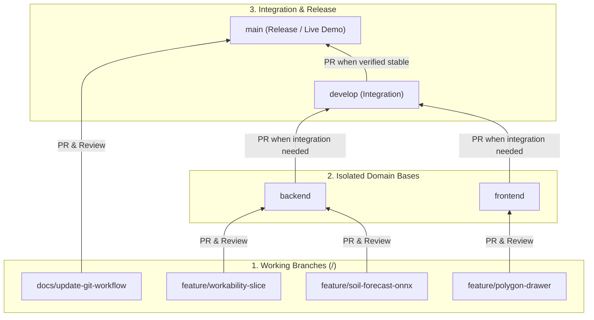

# FarmFlow NASA — Git & Pull Request Workflow

> **Golden Rule:** **NO direct or blind pushes** to `main`, `develop`, `backend`, or `frontend`. Every change—no matter how small—must be pushed to a short-lived branch (`<kind-of-work>/<work-done>`) and merged via an approved Pull Request (PR).

---

## 1. Branch Naming Convention

All branches must follow the standard:
```text
<kind-of-work>/<work-done>
```

Categorize branches by the **kind of work** being done (never by domain like `backend/` or `frontend/`, which causes Git ref collisions with long-lived base branches):

| Kind of Work | Usage | Example |
| :--- | :--- | :--- |
| **`feature/`** | New functionality, API slices, ML models, UI components | `feature/workability-window-slice`<br>`feature/soil-moisture-lstm-onnx`<br>`feature/map-polygon-drawer` |
| **`fix/`** | Bug fixes, formula corrections, CI or runtime adjustments | `fix/water-deficit-index-formula`<br>`fix/geojson-srid-projection` |
| **`chore/`** | Tooling, dependency updates, maintenance, cleanup | `chore/update-git-workflow`<br>`chore/setup-docker-postgis` |
| **`docs/`** | Documentation updates, architecture guides, API specs | `docs/update-api-spec`<br>`docs/add-readme-instructions` |
| **`refactor/`** | Code refactoring without changing public behavior | `refactor/extract-nasa-fixture-store` |
| **`ci/`** | GitHub Actions workflows and automation | `ci/add-backend-build-workflow` |

---

## 2. Commit Message Convention

All commit messages must strictly follow the team lead format:

```text
[<type>-<scope>] - <Description>
```

### Format Breakdown:
- **`<type>`**: `feature` | `fix` | `chore` | `docs` | `devops` | `refactor` | `test`
- **`<scope>`**: `backend` | `frontend` | `ml` | `docs` | `main` | `shared`
- **`<Description>`**: Clear description of what was added, changed, or fixed.

### Approved Examples:
```text
[feature-backend] - Implemented .NET 10 API and PostGIS
[feature-backend] - Made temporary mock NASA pipeline
[chore-docs] - Updated Git workflow guide with new branch and commit conventions
[feature-ml] - Trained 7-day soil moisture LSTM and exported to ONNX
[fix-backend] - Corrected surface moisture threshold for optimal workability
[feature-frontend] - Added interactive field polygon drawer on map
[devops-main] - Updated .NET version in CI
```

---

## 3. Long-Lived Branches

| Branch | Purpose | PR Target For |
| :--- | :--- | :--- |
| **`main`** | **Release / Demo Branch.** Stable, production-ready code, root docs, and CI workflows. | Shared `docs/*` / `chore/*` PRs, and `develop` when releasing. |
| **`develop`** | **Integration Branch.** Aggregates backend and frontend only when both are ready for cross-team integration testing. | Integration PRs from `backend` and `frontend`. |
| **`backend`** | **Backend & AI/ML Branch.** Primary base for .NET 10 API, PostGIS, and Python/ONNX ML models. Stays isolated from frontend during active feature work. | Backend and ML `feature/*`, `fix/*`, `chore/*`, `refactor/*` PRs. |
| **`frontend`** | **Frontend Branch.** Primary base for React/UI, map components, and dashboard charts. Stays isolated from backend during active feature work. | Frontend `feature/*`, `fix/*`, `chore/*`, `refactor/*` PRs. |

---

## 4. Branch Flow Diagram



---

## 5. Step-by-Step Developer Workflow

### A. Starting New Work
1. Checkout and pull the latest changes from your base branch (`backend`, `frontend`, or `main`):
   ```bash
   git checkout backend
   git pull origin backend
   ```
2. Create and switch to your branch:
   ```bash
   git switch -c feature/workability-window-slice
   ```

### B. Committing & Pushing
1. Stage your changes:
   ```bash
   git add <files>
   ```
2. Commit using the `[<type>-<scope>] - <Description>` convention:
   ```bash
   git commit -m "[feature-backend] - Implemented workability window and spraying safety slice"
   ```
3. Push to remote:
   ```bash
   git push -u origin feature/workability-window-slice
   ```

### C. Opening & Merging a Pull Request
1. Open a PR on GitHub into the corresponding base branch:
   - Backend / ML work $\rightarrow$ base: **`backend`**
   - Frontend work $\rightarrow$ base: **`frontend`**
   - Documentation / CI $\rightarrow$ base: **`main`**
2. Request a review from your teammate. Once approved and checks pass, merge the PR and delete the feature branch.

### D. End-to-End Integration
- When backend endpoints and frontend components are ready to communicate live:
  1. Open a PR from `backend` $\rightarrow$ `develop`.
  2. Open a PR from `frontend` $\rightarrow$ `develop`.
  3. Verify the integrated system on `develop`.
  4. Open a release PR from `develop` $\rightarrow$ `main`.
