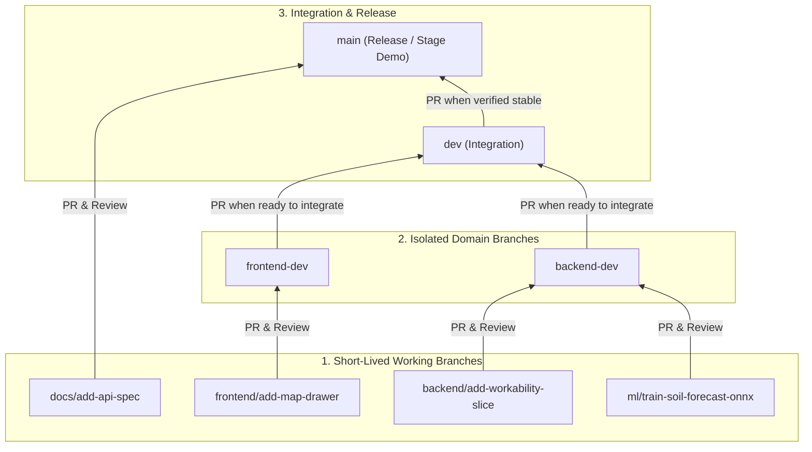

# FarmFlow NASA — Git & Pull Request Workflow

> **Golden Rule:** **NO direct or blind pushes** to `main`, `dev`, `backend-dev`, or `frontend-dev`. Every change—no matter how small—must be pushed to a short-lived feature branch and merged via an approved Pull Request (PR).

---

## 1. Long-Lived Branches

To prevent cross-team merge conflicts during rapid hackathon development, we maintain four protected long-lived branches:

| Branch | Purpose | Who Merges Into It |
| :--- | :--- | :--- |
| **`main`** | **Release / Demo Branch.** Contains stable, production-ready code and shared project documentation. | `dev` (after full integration verification) and `docs/*` PRs directly. |
| **`dev`** | **Integration Branch.** Combines `backend-dev` and `frontend-dev` work **only** when both sides are ready for end-to-end integration testing. | `backend-dev` and `frontend-dev` via integration PRs. |
| **`backend-dev`** | **Backend & AI/ML Aggregate Branch.** Primary working base for `.NET 10` API, PostGIS, and Python/ONNX models. Stays isolated from frontend changes during feature work. | `backend/*` and `ml/*` feature PRs. |
| **`frontend-dev`** | **Frontend Aggregate Branch.** Primary working base for UI, map components, and dashboard views. Stays isolated from backend changes during feature work. | `frontend/*` feature PRs. |

---

## 2. Branch Flow Diagram



---

## 3. Feature Branch Naming & PR Targets

All working branches must follow the pattern:
```text
<domain>/<short-kebab-case-description>
```

| Domain Prefix | Scope of Work | Branch From | Open PR Against (Base Branch) | Example Branch Name |
| :--- | :--- | :--- | :--- | :--- |
| **`docs/`** | Root/shared documentation (`docs/*`, architecture specs) | `main` | **`main`** | `docs/add-api-spec` |
| **`backend/`** | `.NET 10` API, PostGIS, vertical slices, Docker setup | `backend-dev` | **`backend-dev`** | `backend/add-workability-endpoint` |
| **`ml/`** | Python training scripts, datasets, `.onnx` model exports | `backend-dev` | **`backend-dev`** | `ml/export-yield-onnx` |
| **`frontend/`** | UI components, Map/GeoJSON views, state management | `frontend-dev` | **`frontend-dev`** | `frontend/field-polygon-drawer` |

---

## 4. Step-by-Step Developer Workflow

### A. Starting New Work
1. Checkout and pull the latest changes from your target base branch (`backend-dev`, `frontend-dev`, or `main` for docs):
   ```bash
   git checkout backend-dev
   git pull origin backend-dev
   ```
2. Create and switch to your scoped feature branch:
   ```bash
   git checkout -b backend/implement-nasa-client
   ```

### B. Committing & Pushing
1. Stage and commit only the files relevant to your slice (note: `.docs.local/` is local-only and ignored by Git):
   ```bash
   git add <files>
   git commit -m "feat(backend): implement ResilientNasaClient with mock fallback"
   ```
2. Push your feature branch to remote:
   ```bash
   git push -u origin backend/implement-nasa-client
   ```

### C. Opening & Merging a Pull Request
1. Open a Pull Request on GitHub comparing your branch (`<domain>/<change>`) into its corresponding base branch:
   - `backend/*` or `ml/*` $\rightarrow$ **`backend-dev`**
   - `frontend/*` $\rightarrow$ **`frontend-dev`**
   - `docs/*` $\rightarrow$ **`main`**
2. Request review from your teammate. Once approved, merge the PR and delete the short-lived branch.

### D. Cross-Team Integration (`backend-dev` + `frontend-dev` $\rightarrow$ `dev` $\rightarrow$ `main`)
- While features are being built in parallel, `backend-dev` and `frontend-dev` **remain separate** so neither team is blocked or hit with merge conflicts.
- Once endpoints and UI components are ready to connect end-to-end:
  1. Open PRs from `backend-dev` $\rightarrow$ `dev` and `frontend-dev` $\rightarrow$ `dev`.
  2. Test the full integrated stack on `dev`.
  3. Once verified stable, open a release PR from `dev` $\rightarrow$ `main`.
